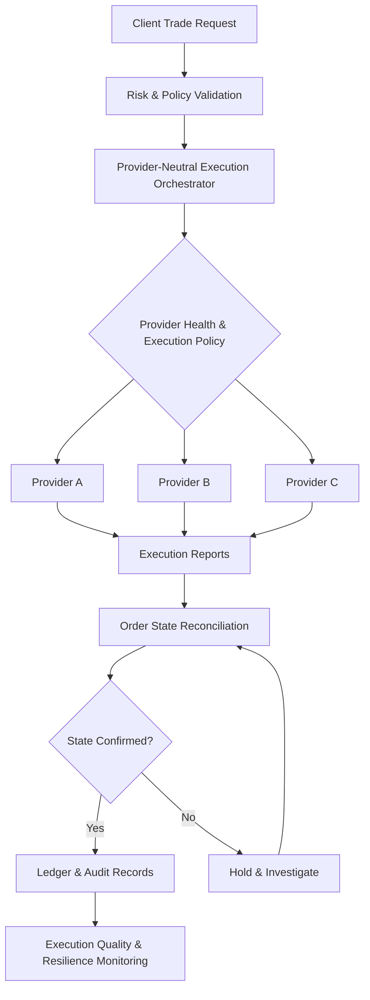

# Institutional Execution Resilience: Best Execution, Multi-Provider Failover & DORA

**Technical Research:** Best Execution & Single-Provider Risk in Institutional Infrastructure

**Author:** Shavez Ahmed Siddiqui  
**Research Area:** Financial Systems Engineering · Digital Asset Infrastructure · Operational Resilience  
**Document Type:** Technical Architecture Reference  
**Project Status:** Conceptual specification — no production implementation

---

## Overview

Modern financial institutions increasingly rely on external Crypto-as-a-Service (CaaS) providers for trading infrastructure, liquidity connectivity, custody integrations, and digital asset transaction processing.

These services simplify financial technology development but introduce a significant architectural concern: dependency on a single external technology provider.

A platform may advertise access to multiple exchanges and liquidity pools while routing every transaction through one API gateway, authentication system, or infrastructure provider.

This creates potential points of failure that can affect execution quality, operational continuity, and transaction integrity.

This repository presents architectural principles for designing institutional execution systems with reduced infrastructure concentration risk.

The research focuses on:

- Single-provider dependency and concentration risk
- Best-execution considerations
- Provider-neutral execution infrastructure
- Active-active and active-passive failover models
- Transaction-state reconciliation
- Operational resilience testing
- EU Digital Operational Resilience Act (DORA) considerations
- Relevant Markets in Crypto-Assets Regulation (MiCA) execution obligations

**Core engineering principle:** Financial infrastructure should remain reliable not only during normal operations but also when critical technology providers experience disruption.

## 1. Problem Definition: Single-Provider Dependency

External providers often combine numerous financial infrastructure services behind unified APIs.

While convenient, this model may conceal operational dependencies.

A financial platform connected to multiple exchanges through a single provider may still experience a complete execution interruption if that provider becomes unavailable.

Three major forms of concentration risk should be considered.

### Technology Concentration

Multiple services depend on a common technology environment, authentication mechanism, network, or service provider.

A single failure can interrupt otherwise independent business functions.

### Liquidity Concentration

Execution depends on a limited group of venues or counterparties.

This can restrict access to competitive prices, available market depth, and suitable execution conditions.

### Operational Concentration

Transaction reconciliation, order management, recovery processes, or critical operating records depend primarily on one provider.

Loss of access may impair the institution's ability to establish the status of outstanding transactions.

A resilient architecture must identify and assess these dependencies separately.

## 2. Best Execution as an Engineering Requirement

Best execution involves evaluating multiple factors relevant to the outcome of a client order.

Depending on the applicable regulatory framework and execution policy, relevant factors may include:

- Transaction price
- Trading and infrastructure costs
- Order-book depth
- Execution speed
- Probability of execution
- Likelihood of settlement
- Order size and market conditions
- Venue reliability
- Applicable custody arrangements

A venue displaying the lowest quoted price does not necessarily provide the best overall execution outcome.

### Illustrative Scenario

Consider three eligible execution venues.

| Venue | Quoted Price | Liquidity | Operational Condition |
|---|---|---|---|
| A | Lowest | Limited | Elevated latency |
| B | Slightly higher | Deep | Normal |
| C | Competitive after fees | Moderate | Normal |

Routing exclusively through Venue A could lead to incomplete execution, additional market impact, or delayed settlement.

A provider-neutral decision engine can evaluate the relative suitability of each venue.

Execution choices should remain subject to the institution's execution policies and risk limits.

## 3. Provider-Neutral Execution Architecture

A provider-neutral architecture separates the institution's internal order-management functions from external connectivity providers.

Rather than embedding provider-specific workflows directly into business applications, the system introduces an orchestration layer.

### Core Components

**Client Request Layer**

Receives trade instructions and verifies request integrity.

**Risk and Policy Validation**

Applies pre-trade limits, eligibility rules, and execution restrictions.

**Execution Orchestrator**

Maintains the institution's internal transaction identifiers, routing decisions, and execution state.

**Provider Health Monitoring**

Evaluates connectivity, response latency, rejection rates, and infrastructure availability.

**Provider Adapters**

Translate internal orders into supported external API formats.

**Reconciliation Engine**

Processes acknowledgments, execution reports, order status, and uncertain outcomes.

**Audit and Monitoring Layer**

Preserves relevant operational records and execution-quality metrics.

### Architecture Diagram



This diagram illustrates a conceptual architecture. It does not represent a deployed or independently tested trading system.

## 4. Active-Active and Active-Passive Failover Models

Two commonly considered infrastructure designs are active-active and active-passive configurations.

### Active-Active Architecture

Multiple execution providers or connectivity routes remain operational simultaneously.

Potential advantages include:

- Continuous alternative-route availability
- Ongoing provider-performance comparison
- Flexible execution allocation
- Reduced dependence on a single primary service

Challenges include:

- More complex order-state coordination
- Cross-provider reconciliation
- Additional operational monitoring
- Increased infrastructure cost

### Active-Passive Architecture

One provider processes transactions during normal operations, while another is maintained as a recovery option.

Potential advantages include simpler normal-operation routing and more controlled failover processes.

However, the backup environment must remain sufficiently prepared for real use.

Relevant requirements include working credentials, funded accounts where necessary, operational permissions, compatible order capabilities, and valid execution arrangements.

Neither architecture is universally superior.

Selection should reflect the institution's transaction volumes, business requirements, risk appetite, and recovery objectives.

## 5. Financial Integrity During Provider Failover

Failover introduces a critical problem when the execution status of an order becomes uncertain.

Consider the following sequence:

1. A client submits an order.
2. The system forwards the instruction to Provider A.
3. Provider A receives the instruction.
4. Connectivity fails before the acknowledgment reaches the institution.
5. The institution cannot immediately determine the execution outcome.

Three possible states exist:

- The provider never received the order.
- The order remains open.
- The order was partially or fully executed.

Automatically submitting an identical instruction through Provider B could create unintended duplicate exposure.

### Recommended State Model

```text
CREATED
   |
VALIDATED
   |
SUBMITTED
   |
   +-- ACKNOWLEDGED
   |       |
   |       +-- PARTIALLY_FILLED
   |       |        |
   |       |        +-- FILLED
   |       |        +-- CANCELLED
   |       |
   |       +-- FILLED
   |       +-- CANCELLED
   |       +-- REJECTED
   |
   +-- UNKNOWN_STATUS
           |
           +-- RECONCILIATION_REQUIRED
                       |
                       +-- STATUS_CONFIRMED
                       +-- MANUAL_REVIEW
```

This is an illustrative state model. Actual exchange interfaces may require additional states, including pending cancellation, expiry, replacement, and correction handling.

### Reconciliation Requirements

Before rerouting an uncertain order, the system should attempt to recover its original status using:

- Persistent order identifiers
- Provider order references
- Execution reports
- Open-order inquiries
- Historical transaction records
- Current exposure and position information

If the outcome remains uncertain, the instruction may need to be suspended pending investigation.

A successful failover is not simply one that restores connectivity.

It is one that restores safe processing without losing control of existing financial obligations.

## 6. DORA: ICT Third-Party Risk and Operational Resilience

The EU Digital Operational Resilience Act (DORA), Regulation (EU) 2022/2554, has applied since January 17, 2025.

It establishes requirements for digital operational resilience across in-scope financial entities.

Relevant areas include:

- ICT risk management
- ICT-related incident management and reporting
- Digital operational resilience testing
- ICT third-party risk management
- Relevant information-sharing arrangements

### Article 28: Third-Party Risk Management

DORA Article 28 addresses the management of ICT third-party risk.

A central principle is that regulated financial entities remain responsible for applicable obligations when using external ICT service providers.

For relevant critical or important functions, institutions must consider dependencies, concentration risk, contractual requirements, and appropriate exit arrangements.

### Architectural Implications

An institution may implement controls supporting these objectives through:

1. Mapping critical third-party dependencies.
2. Identifying shared infrastructure and potential common points of failure.
3. Monitoring service performance and availability.
4. Maintaining incident-response procedures.
5. Documenting recovery and provider-exit arrangements.
6. Testing appropriate continuity and recovery scenarios.
7. Retaining evidence of operational and risk-management decisions.

**Important regulatory distinction:** DORA does not establish a universal requirement to maintain multiple execution providers.

The appropriate architecture depends on the institution's actual dependencies, risk assessment, contractual arrangements, and applicable obligations.

## 7. MiCA and Best-Execution Considerations

Regulation (EU) 2023/1114, known as MiCA, includes execution-related requirements for relevant crypto-asset service providers.

Article 78 addresses execution of crypto-asset orders on behalf of clients.

Relevant obligations include execution arrangements, execution policies, consideration of appropriate execution factors, and ongoing evaluation of execution quality.

The regulation distinguishes these obligations from cases involving qualifying specific client instructions.

For systems engineering, this highlights the importance of maintaining records capable of explaining:

- Why a venue or provider was selected
- Which execution factors were considered
- Whether restrictions or client instructions applied
- How orders were executed
- Whether execution arrangements remain effective

DORA and MiCA address different responsibilities.

DORA concerns operational resilience and ICT risk, while MiCA Article 78 concerns execution of client orders by relevant service providers.

Both can inform the architecture of institutional digital asset platforms.

## 8. Operational Resilience Testing

A documented failover procedure is useful only if the system can behave safely during actual disruptions.

The following scenarios can form part of a conceptual resilience-testing programme.

| Scenario | Test Objective | Expected Safe Behavior |
|---|---|---|
| Primary API outage | Evaluate recovery | Disable affected route and assess eligible alternatives |
| Stale market data | Validate market data controls | Reject unreliable execution inputs |
| Lost acknowledgment | Protect transaction integrity | Reconcile original order before rerouting |
| Elevated provider latency | Identify degraded performance | Apply health and execution-policy thresholds |
| Partial execution | Preserve correct exposure | Reconcile confirmed fills and remaining quantity |
| Reconciliation mismatch | Detect inconsistent records | Flag exception and prevent unsafe duplicate actions |

### Suggested Test Assertions

A future implementation should demonstrate that:

- No order bypasses mandatory pre-trade risk validation.
- An unknown order outcome does not automatically trigger duplicate execution.
- Invalid or stale market data is excluded from eligible routing decisions.
- Provider outages do not destroy locally maintained order-state records.
- Execution decisions and recovery actions are auditable.
- Reconciliation discrepancies enter defined investigation procedures.

These assertions are proposed acceptance criteria, not results from completed tests.

## 9. Monitoring and Performance Indicators

Operational resilience should be evaluated together with execution quality.

Useful indicators include:

**Availability Metrics**

- Provider uptime
- Connectivity failure rates
- Alternative-route availability

**Execution Metrics**

- Order acknowledgment latency
- Rejection rates
- Fill rates
- Execution completion times
- Effective transaction costs

**Recovery Metrics**

- Time to detect provider degradation
- Time to restore eligible processing
- Transactions requiring manual reconciliation
- Unresolved transaction-state duration

**Governance Metrics**

- Completion of recovery tests
- Identified concentration risks
- Open remediation actions
- Third-party incident records

A system may report strong infrastructure uptime while producing poor execution outcomes.

Conversely, strong execution under normal conditions does not establish resilience during provider failure.

Both dimensions require continuous evaluation.

## 10. Reference Implementation Checklist

A prospective engineering implementation should address the following requirements.

### Architecture

- [ ] Separate internal order management from provider-specific APIs
- [ ] Define a normalized execution request model
- [ ] Implement independent provider adapters
- [ ] Maintain persistent internal order identifiers
- [ ] Define eligibility and provider-selection policies

### Financial Controls

- [ ] Enforce mandatory pre-trade risk limits
- [ ] Detect duplicate transaction requests
- [ ] Support explicit uncertain-order states
- [ ] Reconcile partial fills and cancellations
- [ ] Preserve auditable execution records

### Resilience

- [ ] Establish provider-health thresholds
- [ ] Document provider outage procedures
- [ ] Test partial-execution failure scenarios
- [ ] Validate recovery-route readiness
- [ ] Define exception escalation and investigation procedures

### Governance

- [ ] Document critical service dependencies
- [ ] Assess third-party concentration risks
- [ ] Maintain applicable operational continuity procedures
- [ ] Evaluate relevant DORA requirements
- [ ] Review applicable MiCA execution requirements

This checklist is intended to guide engineering evaluation. Completing it does not establish regulatory compliance or production readiness.

## 11. Research Scope and Limitations

This repository is a technical architecture reference derived from research into institutional execution infrastructure and operational resilience.

It is not:

- A production trading engine
- A live execution service
- A certified compliance solution
- An independently audited financial platform
- Evidence of regulatory approval
- A validated provider failover implementation

Any production use would require additional software development, independent testing, security review, operational controls, and legal and regulatory assessment.

## 12. Conclusion

Institutional financial infrastructure increasingly depends on specialized external technology services.

While these services provide operational and development advantages, concentration risk must be addressed through clear engineering boundaries and appropriate governance.

Provider-neutral execution architecture, reliable transaction-state management, controlled failover procedures, and independent reconciliation can help institutions reduce operational dependencies.

DORA reinforces the importance of digital operational resilience, while MiCA establishes relevant execution requirements for applicable crypto-asset service providers.

**The objective is not to eliminate infrastructure dependencies. It is to understand, govern, and manage them without compromising financial integrity.**

---

## References

1. [Regulation (EU) 2022/2554 — Digital Operational Resilience Act](https://eur-lex.europa.eu/legal-content/EN/TXT/?uri=CELEX:32022R2554)
2. [ESMA — Digital Operational Resilience Act](https://www.esma.europa.eu/esmas-activities/digital-finance-and-innovation/digital-operational-resilience-act-dora)
3. [Regulation (EU) 2023/1114 — Markets in Crypto-Assets](https://eur-lex.europa.eu/legal-content/EN/TXT/?uri=CELEX:32023R1114)

## Author

**Shavez Ahmed Siddiqui**

Fintech entrepreneur with interests in blockchain infrastructure, digital payments, financial execution systems, and institutional technology architecture.

**Official Website:** https://shavezahmedsiddiqui.com/

**Research Article:** Best Execution & Single-Provider Risk in Institutional Infrastructure

**Disclaimer:** This material provides general technical and regulatory analysis for educational purposes. It does not constitute investment, legal, or regulatory advice.
